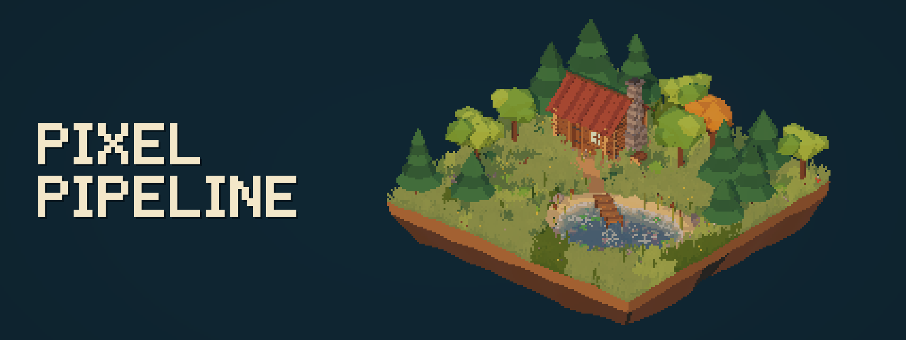

Pixel Pipeline turns a regular 3D URP scene into pixel art. The scene is rendered at a low internal
resolution and upscaled sharply, with outlines, banded lighting, and hard pixel shadows applied on
top. Your existing URP Lit and Shader Graph materials work as they are.

It targets **Unity 6000.3+** and **URP 17** on PC. Mobile is not a supported target.

## What it does

- **Pixel rendering** — low internal resolution, sharp upscale, and depth/normal outlines.
- **Banded lighting and pixel shadows** — light falls in flat steps and shadow edges are one pixel
  wide, for the sun and for point and spot lights.
- **Day/night and weather** — a sun and moon cycle with Sunny, Cloudy, and Rain states that blend
  into each other.
- **Clouds and god rays** — moving cloud shadows on the ground, and light shafts through the gaps.
- **Rain** — pixel rain that lands and splashes on any surface.
- **Wind** — one shared wind direction for grass, foliage, clouds, rain, water, and wind streaks.
- **Grass and tree foliage** — GPU-instanced billboard grass and camera-facing leaf cards.
- **Water** — banded depth colour, refraction, shore foam, glints, waves, and planar reflection.
- **Isometric camera** — an optional pixel-perfect orthographic camera controller.

## Quick start

### 1. Install

In **Window > Package Manager > + > Install package from git URL**, enter:

```
https://github.com/schyro/PixelPipeline.git
```

URP and the Input System are installed with it as dependencies.

### 2. Set up the renderer

1. Create a settings asset: **Assets > Create > Rendering > Pixel Pipeline Settings**.
2. Select your URP renderer asset and set **Rendering Path** to **Deferred+**.
3. Add **Pixel Renderer Feature** to the renderer and assign the settings asset to it.
4. Run **Tools > Pixel Pipeline > Configure Renderers**.

The scene now renders as pixel art, with outlines, banded lighting, and pixel shadows.

### 3. Add day/night and weather (optional)

1. Add `PixelEnvironmentController` to an empty GameObject and assign the settings asset, the Sun
   light, the camera, and optionally a Moon light.
2. Open **Tools > Pixel Pipeline > Settings Window** and assign:
   - **Clouds** page: `CloudNoise` from the package's `Textures` folder.
   - **Rain** page: `MAT_PixelRain` and `MAT_RainSplash` from the package's `Materials` folder.
   - **Wind Streaks** page: `MAT_WindStreaks`.
3. For rain, add `PixelRainRenderer` to the same GameObject and assign the controller. For wind
   streaks, do the same with `PixelWindStreakRenderer`.

## Placing grass

1. Give the ground a collider. Grass is placed by raycasting down onto it.
2. Add `GrassSpawner` to an empty GameObject.
3. Assign Unity's built-in **Quad** to **Grass Mesh** and `MAT_Grass` to **Grass Material**.
4. Set **Terrain Layer** to the ground's layer, then move and size **Spawn Area** so the box
   contains the ground that should have grass. Rays start at the top of the box and stop at its
   bottom, so the ground has to be inside it vertically too.
5. Set **Grass Count**, and the blade size under **Scale**.

Grass is generated at runtime, so it appears in Play mode. After changing placement values while
playing, use **Regenerate Grass** from the component's context menu.

For ground that matches the grass colours, use `MAT_GrassTerrain` on the ground mesh.

## Placing tree foliage

1. Create an empty GameObject where the tree crown should be and add `PixelFoliageCanopy`. It adds
   a MeshFilter and MeshRenderer.
2. Assign `MAT_Foliage` to the MeshRenderer.
3. Scale the GameObject to size the crown.
4. Optionally assign a **Canopy Shape** mesh (a closed mesh with Read/Write enabled) to follow your
   own crown shape. A sphere is used otherwise.
5. Adjust **Card Count** and **Card Size** for how dense and how large the leaves are.

The leaves are generated in the editor and update as you change the component.

Materials in an installed package are read-only. To change grass or leaf colours, duplicate
`MAT_Grass` or `MAT_Foliage` into your `Assets` folder and use the copy.

## Where the settings are

Everything is in one place: **Tools > Pixel Pipeline > Settings Window**. The same window opens
from **Open Pixel Pipeline Window** in the settings asset's Inspector.

| Page         | Controls                                                    |
| ------------ | ----------------------------------------------------------- |
| Resolution   | Internal pixel resolution and which cameras are affected    |
| Outline      | Silhouette and crease lines                                 |
| Lighting     | Light bands and pixel shadows                               |
| Wind         | Shared wind direction and strength                          |
| Day & Night  | Day length, sun and moon, sky and ambient colours           |
| Weather      | Cloud coverage, rain timing, and lighting per weather state |
| Clouds       | Cloud shadow shape, speed, and strength                     |
| God Rays     | Light shafts through the cloud gaps                         |
| Wind Streaks | Stylised wind trails                                        |
| Rain         | Drops, splashes, and what stops the rain                    |
| Water        | Colours, foam, glints, waves, and reflection                |

Most pages show a live preview, and edits apply to the Scene and Game views immediately, with undo.

Per-scene values (the current time and the current weather) are on the scene's
`PixelEnvironmentController`. Per-object values are on each component and material.

## More

- [Technical reference](Documentation~/TechnicalReference.md) — what each setting changes, how each
  system works, and its limits.
- [Changelog](CHANGELOG.md)
- [License](LICENSE.md) — MIT
